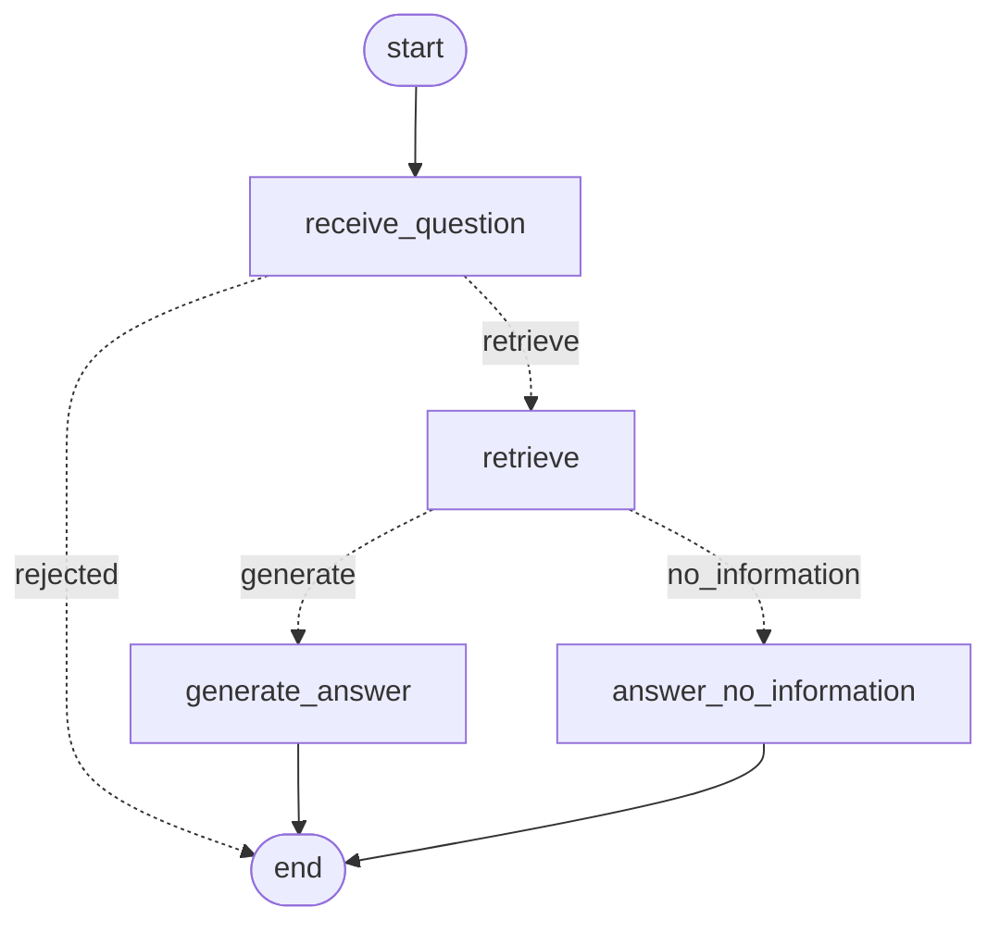

# Knowledge agent: the RAG flow as a LangGraph graph

Milestone 7, Part 1. Ticket: `lead-instr.png`, checklist in `stages-todo.png`. The RAG system it builds on is described in [`docs/rag/rag-design.md`](../rag/rag-design.md).

## Why

`POST /knowledge/query` works, but it is a black box: a question goes in and an answer comes out, and nobody can see which decisions were taken along the way. The ticket asks for **the same behaviour**, with `retrieve` and `embed` reused rather than rewritten, running inside a LangGraph graph:
- single-responsibility nodes;
- a minimal, explicit state;
- conditional transitions;
- compile-time structural checks;
- a checkpoint at every transition;
- a queryable trace for every run;
- evals that run against those traces.

The graph is also the extension point for Part 2. A new tool will be a new node plus a conditional edge that decides when to use it, and the rest of the flow stays untouched.

## The graph



`npm run agent -- check` compiles the graph and prints its node contracts, its version and this diagram, drawn by LangGraph itself (`draw_mermaid()`).

### State: what the nodes share

| Field | Written by | Why it is there |
|---|---|---|
| `question` | caller; `receive_question` stores the stripped form | Every later node needs it |
| `error` | `receive_question` | Lets `route_question` end the run without retrieving |
| `context` | `retrieve` | `rag.retrieve()` output, possibly `[]`. `route_context` routes on it and `generate_answer` reads it. |
| `answer` | `generate_answer` or `answer_no_information` | The result |

There is **no conversation history**. One question gets one answer, and no node reads an earlier turn. A new field, such as tool results in Part 2, has to come with the node that reads it.

How a run ended (`answered`, `no_information` or `rejected`) is derived from these fields (`state.derive_outcome`), so it needs no field of its own. `answered` means "generated from retrieved context"; that answer may still say the documents do not cover the question (see the out-of-scope eval).

### Nodes: one job each

Each node declares the fields it reads and the fields it writes ([`services/agent/graph.py`](../../services/agent/graph.py) `NODES`).

| Node | Reads → writes | Does |
|---|---|---|
| `receive_question` | question → question, error | Strips the question and refuses an empty one |
| `retrieve` | question → context | `rag.retrieve(question)`: k=5, `MIN_SCORE` 0.30, unchanged |
| `generate_answer` | question, context → answer | `rag.generate_answer(question, context)` with the context `retrieve` produced. It refuses an empty context. |
| `answer_no_information` | — → answer | A fixed honest answer ("I don't have information about that…"), with no model call |

The node contract from the ticket holds. `retrieve` calls `retrieve()`, and `generate_answer` calls the RAG project's generation function with the context that `retrieve` already produced. **`rag.query()` is never called**: it would run retrieval again inside one opaque step. The tests replace `rag.query` with a function that fails.

### Transitions: real conditions, each recorded with its reason

| After | Router | Condition → next node |
|---|---|---|
| `START` | — | → `receive_question` |
| `receive_question` | `route_question` | `error` set → **`END`**, so an empty question is never retrieved. Otherwise → `retrieve`. |
| `retrieve` | `route_context` | No chunk ≥ 0.30 → `answer_no_information`, so generation never runs on an empty context. Otherwise → `generate_answer`. |
| `generate_answer`, `answer_no_information` | — | → `END` |

Each router writes its decision, the target and the reason (for example "no chunk scored at least 0.30") to the run's stream. The trace stores it as an `edge` row.

**One behaviour change from `query()`:** with no context above the threshold, `query()` still called the model, and the model said it had no information. The graph answers with fixed text and no model call, as the ticket asks.

## Compiled before any execution

`build_agent_graph()` validates and compiles. It raises `AgentGraphBuildError` with a message naming the culprit. `get_agent_graph()` is called in the API's lifespan, so a broken graph stops startup instead of failing a request.

| Structural error | Caught by |
|---|---|
| Edge to or from an unknown node, a decision leading to an unknown node, no entry point | LangGraph's own `compile()`, with the error wrapped in our message |
| A node nobody routes to (unconnected) | Our reachability check from `START` |
| A node with no way to `END` (dead end) | Our reachability check towards `END` |
| A node declaring a field `AgentState` does not have, a node named like a state field, a node declared twice | Our contract check |
| A node *returning* a field outside its declared writes (at run time) | `AgentContractError` from the node wrapper |

Two of these were checked against LangGraph 1.2.20 before relying on it. `compile()` accepts a node with no edges, and a node that returns an unknown key has that key **silently dropped**. The reachability check runs on our declarations, not on `compiled.get_graph()`: the drawn graph adds an implicit edge to `END` for a dead-end node, which would hide one. The tests cover each row (`test_a_structural_error_fails_compilation_with_a_clear_message`).

## Checkpoints: inspect or resume a run

The graph is compiled with LangGraph's `SqliteSaver` (`langgraph-checkpoint-sqlite`). It stores a checkpoint after every step, under `thread_id = run_id`:
- the input;
- `receive_question`;
- `retrieve`;
- `generate_answer` or `answer_no_information`.

- **Inspect** a run with `get_agent_graph().get_state_history({"configurable": {"thread_id": run_id}})`.
- **Resume** with `npm run agent -- resume <run_id>`. A run that failed at a node, for example because the model gateway timed out, continues from that node. The steps that succeeded are not run again: the last checkpoint already holds the retrieved context.

Verified live on 2026-11-11. With the generation endpoint unreachable, a run failed at `generate_answer`. After the resume, the trace showed attempt 2 running `generate_answer` only, with no second `retrieve`.

The store file is `AGENT_STORE_PATH`:
- default `data/agent/agent_runs.sqlite`, git-ignored because it holds the questions people asked;
- in Compose, `/app/var/agent_runs.sqlite` on the `api_data` volume.

## Trace: every run is queryable after it ends

[`services/agent/runner.py`](../../services/agent/runner.py) streams the graph with the `tasks` mode (a start and an end event per node), the `custom` mode (the routers' decisions) and the `values` mode (the final state). [`services/agent/tracing.py`](../../services/agent/tracing.py) writes the result to two tables in the store file.

| Table | One row per | Columns |
|---|---|---|
| `agent_runs` | run | `run_id`, `user_id`, `graph_version`, `question`, `status` (running / completed / failed), `outcome`, `answer`, `attempts`, `started_at`, `finished_at`, `error_node`, `error_type`, `error_message` |
| `agent_run_events` | node run or decision | `run_id`, `seq`, `attempt`, `kind` (node / edge), `name`, `status`, `started_at`, `finished_at`, `duration_ms`, `input_json` (only the fields the node declares it reads), `output_json` (its state update, or the decision and reason), `error_type`, `error_message` |

Errors keep their class. The message is kept only for `KnowledgeBaseError` and `AgentContractError`, whose messages are written to be logged: they never carry a URL or a key.

`graph_version` is a hash of the nodes, edges, system prompt, threshold, top-k, temperature and fixed answers (`graph_fingerprint()`). It shows which version of the agent answered.

Three ways to read a trace:

```bash
npm run agent -- trace --last            # or: trace <run_id> [--json]; runs [--limit N]
curl -H "Authorization: Bearer $TOKEN" localhost:8000/agent/runs/<run_id>
sqlite3 data/agent/agent_runs.sqlite \
  "SELECT seq, attempt, kind, name, status, duration_ms FROM agent_run_events
   WHERE run_id = '<run_id>' ORDER BY seq"
```

A real trace (2026-11-11):

```
Run d80787e2-… · completed · answered · graph b80c9d0318e7aba2 · 1 attempt(s)
Question: What's the standard return window?
  1  [1] node receive_question        0.4 ms  {"question": "What's the standard return window?"}
  2  [1] edge route_question                  -> retrieve (retrieve): the question is not empty
  3  [1] node retrieve             5744.9 ms  4 chunk(s): returns-policy#1=0.754, returns-policy#0=0.366, …
  4  [1] edge route_context                   -> generate_answer (generate): 4 chunk(s) scored at least 0.30
  5  [1] node generate_answer      4060.8 ms  {"answer": "The standard return window is 30 days from delivery, …"}
```

LangSmith was not used. The trace is our own structured store, so the evals can read it offline.

## Evals: run against recorded traces

- **Cases:** [`data/eval/agent/eval-cases.json`](../../data/eval/agent/eval-cases.json). Each case is a question plus verifiable criteria.
- **Recording:** `LLM_TIMEOUT_SECONDS=120 npm run agent:record` runs each case once through the real graph, with Qdrant and the 4Geeks models. It writes [`data/eval/agent/traces.json`](../../data/eval/agent/traces.json), which is committed.
- **Evals:** `npm run agent:eval` runs [`tests/pipelines/test_agent_evals.py`](../../tests/pipelines/test_agent_evals.py). They read only that file, so they need no service and are also part of `npm run test:api`.

| Case | Checks |
|---|---|
| `route-empty-question` | Only `receive_question` ran, the decision went to `END`, and nothing was retrieved |
| `route-no-information-unrelated`, `-near-threshold` (scores 0.093 and 0.201) | receive → retrieve → `answer_no_information`; `generate_answer` never ran; the answer is the fixed text |
| `grounding-standard-delivery-times` | "3 to 5 business days" is in the answer **and** in a retrieved chunk, plus the high-demand caveat |
| `grounding-black-friday-sla` | The SLA is not guaranteed |
| `grounding-international-returns` | Manual handling, Sofía Ramos |
| `grounding-storage-discount` | Miguel Torres |
| `grounding-carrier-exception` | Carlos Vega |
| `grounding-return-window` | "30 days" |
| `out-of-scope-above-threshold` (parental leave, 0.449) | The run reaches generation, and the answer still says the knowledge base lacks the information |

Checked on every case or every answered case:
- **Routing:** exact node order, nodes that must not run, the outcome, and every decision leading to the node that actually ran next, with a reason.
- **Node contract:** `retrieve` ran exactly once, before `generate_answer`, and the generation step's input context equals `retrieve`'s output.
- **Faithfulness (BRIEFING §4):** every figure in an answer appears in the retrieved chunks or in the question.
- **Freshness:** traces recorded by another graph version, prompt or threshold fail the evals with "re-record".

Grounding is the acceptance gate. A perfect route with an answer that ignores the BRIEFING policies fails. These evals come **in addition to** the RAG tests, which still pass unchanged.

**Result (2026-11-11, gpt-6-luna / pplx-embed-v1-0.6b, graph `b80c9d0318e7aba2`): 57 of 57 evals pass.**

## API

Both routes need a bearer token and live in [`services/agent/router.py`](../../services/agent/router.py). The router holds no business logic: it calls `runner.run_agent()` and maps how the run ended to a status code. `POST /knowledge/query` and the backoffice page are unchanged.

| Request | Answer |
|---|---|
| `POST /agent/query {question}` | 200 `{run_id, answer}` |
| …empty question (the graph refuses it) | 422 `{detail: {message, run_id}}` |
| …malformed body, extra field, over 1000 characters | 422, and the graph never runs |
| …Qdrant or a model unavailable or not configured | 503 `{detail: {message, run_id}}`. The message names the failed step, for example "the 'retrieve' step is unavailable right now". |
| …any other node failure | 500 with the same shape. Never the exception text or a traceback. |
| `GET /agent/runs/{run_id}` | 200 with the run and its events in order. 404 for an unknown run **or another user's run**, because questions may carry client details. 422 for a non-UUID id. |

Verified live on 2026-11-11 against the real app (uvicorn, with a throwaway Postgres because Supabase was unreachable): a 200 answer with its trace, a 422 for a blank question, a 401 for a trace read without a token, and a 503 with the cause only in the server log when Qdrant was stopped.

## Files

| Path | What |
|---|---|
| `services/agent/state.py` | `AgentState`, node names, fixed answers, `derive_outcome` |
| `services/agent/nodes.py` | The four nodes |
| `services/agent/graph.py` | Contracts, routers, `build_agent_graph`, checks, fingerprint, the app's checkpointed graph |
| `services/agent/tracing.py` | `TraceStore` |
| `services/agent/runner.py` | `run_agent`, `resume_run` |
| `services/agent/router.py`, `models.py` | HTTP |
| `services/agent/__main__.py` | CLI (`npm run agent -- check / ask / trace / runs / resume`) |
| `services/agent/config.py` | `AGENT_STORE_PATH` |
| `scripts/record_agent_traces.py` | `npm run agent:record` |
| `tests/pipelines/test_agent_graph.py` (40) | Compilation errors, nodes on their own, routes, checkpoints, resume, trace |
| `tests/pipelines/test_agent_evals.py` (57) | The evals |
| `tests/pipelines/test_record_agent_traces.py` (8) | The recorder |
| `tests/test_agent_api.py` (19) | The endpoints, startup compilation |

## Known limitations

- The no-information answer is English. A Spanish question with no context above the threshold gets an English reply; generated answers still follow the question's language.
- The trace store has no retention purge.
- SQLite suits one API instance. Several instances would need the Postgres checkpointer and a shared trace table.
- Business-sounding out-of-scope questions above 0.30 still reach generation, because the threshold is recall-first (see `rag-design.md`). The prompt handles them, and eval `out-of-scope-above-threshold` covers that.
- A run whose process was killed mid-run stays `running` in the trace and is not resumable from the CLI.
- The eval traces are a snapshot. Re-record them after any change to the graph, prompt or threshold, which the freshness check enforces, or after a model change, which it does not detect.
