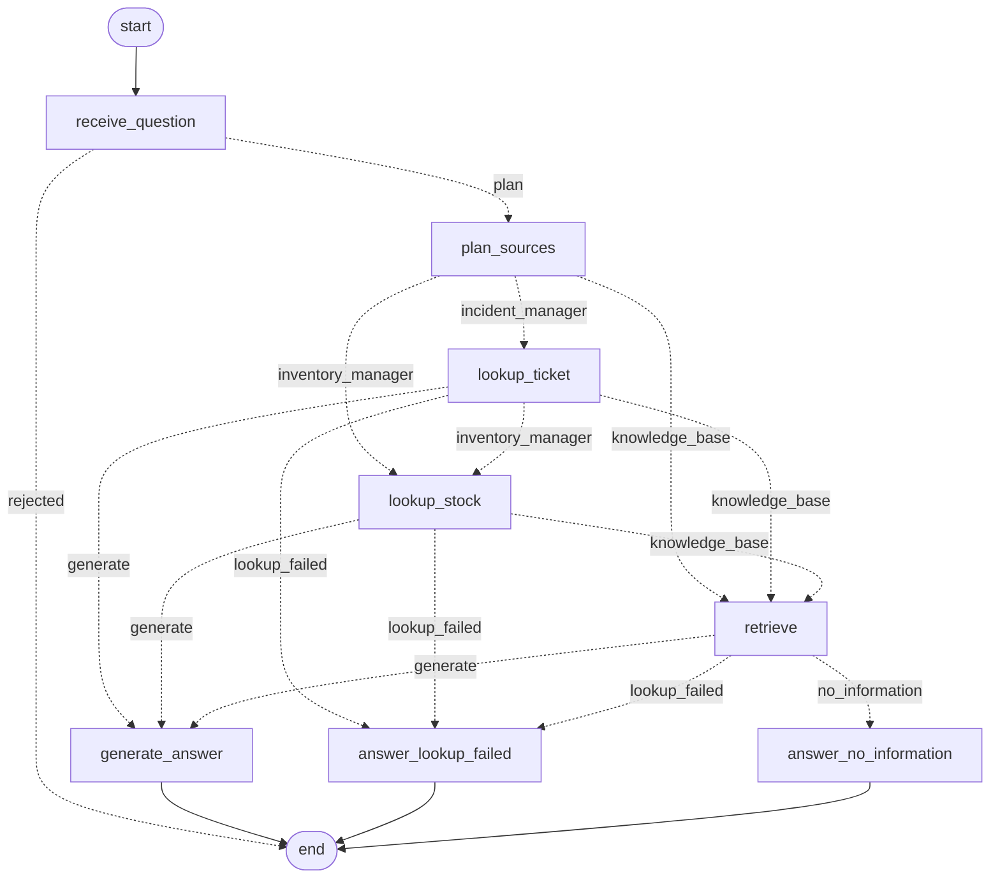

# Knowledge agent: the RAG flow as a LangGraph graph, plus live tools

Milestone 7. Ticket: `lead-instr.png`, checklist in `stages-todo.png`. The RAG system it builds on is described in [`docs/rag/rag-design.md`](../rag/rag-design.md).

- **Part 1** made the RAG flow an explicit, traceable graph.
- **Part 2** gives the agent two read-only tools for data that changes all the time, and lets it decide on its own which source a question needs:
  - the live state of support tickets in the **incident manager**;
  - the live stock in the **inventory manager**, the stretch goal.

## Why

**Part 1.** `POST /knowledge/query` worked, but it was a black box. The ticket asked for **the same behaviour** inside a LangGraph graph, with `retrieve` and `embed` reused rather than rewritten:
- single-responsibility nodes and a minimal, explicit state;
- conditional transitions and compile-time structural checks;
- a checkpoint at every transition, a queryable trace for every run, and evals that run against those traces.

**Part 2.** The knowledge base answers policy and procedure questions well. "What's the status of ticket 482?" is different: that answer is not in the documents, it is in the incident manager, and without a way to look it up the agent made something up.

Tickets are **not** indexed into the vector store. A ticket's status changes in real time; an indexed copy goes stale the moment someone moves it. The RAG keeps the stable knowledge (policies, procedures), and a tool reads the live operational data from the service that owns it, every time.

## The graph



`npm run agent -- check` compiles the graph and prints its node contracts, its version and this diagram, drawn by LangGraph itself (`draw_mermaid()`).

How a run flows:
1. `plan_sources` asks the model which sources the question needs.
2. The planned sources run in a fixed order: **ticket, stock, knowledge base**. Live data comes first, and the same plan always gives the same trace.
3. After the last source, the evidence decides how the run is answered:

| Evidence (chunks, or a lookup that succeeded) | A lookup failed | Answer |
|---|---|---|
| yes | no | `generate_answer` |
| yes | yes | `generate_answer`, with the fixed notice for the failed lookup put **in front** of the generated text. The failed lookup never reaches the model. |
| no | yes | `answer_lookup_failed`: a fixed, honest answer with no model call |
| no | no | `answer_no_information`: the Part 1 fixed answer |

### State: what the nodes share

| Field | Written by | Why it is there |
|---|---|---|
| `question` | caller; `receive_question` stores the stripped form | Every later node needs it |
| `error` | `receive_question` | Lets `route_question` end the run before anything else |
| `plan` | `plan_sources` | The sources to consult, in order, with each tool's validated arguments (`planner.Plan`) |
| `ticket_lookup` | `lookup_ticket` | `TicketLookupResult`: outcome, the request made, the tickets, timing |
| `stock_lookup` | `lookup_stock` | `StockLookupResult`, the same shape for products |
| `context` | `retrieve` | `rag.retrieve()` output, possibly `[]` |
| `answer` | `generate_answer`, `answer_lookup_failed` or `answer_no_information` | The result |

There is **no conversation history**. One question gets one answer, and no node reads an earlier turn. Each new field came with the node that reads it. Tool results are stored as JSON-mode dicts, so the checkpointer and the trace store them as they are.

How a run ended (`answered`, `no_information` or `rejected`) is derived from these fields (`state.derive_outcome`):
- `answered` means "generated from evidence": retrieved chunks or a lookup that succeeded.
- A run that could only give a fixed answer is `no_information`, whether nothing was in the knowledge base or a lookup failed. The trace shows which fixed-answer node ran.
- Keeping the three outcomes means the trace store's `CHECK` constraint needed no migration.

### Nodes: one job each

Each node declares the fields it reads and the fields it writes ([`services/agent/graph.py`](../../services/agent/graph.py) `NODES`).

| Node | Reads → writes | Does |
|---|---|---|
| `receive_question` | question → question, error | Strips the question and refuses an empty one |
| `plan_sources` | question → plan | `planner.choose_sources(question)`; see [Routing](#routing-the-agent-decides-the-source) |
| `lookup_ticket` | plan → ticket_lookup | `tools.incidents.lookup_ticket(...)`, live |
| `lookup_stock` | plan → stock_lookup | `tools.inventory.lookup_stock(...)`, live |
| `retrieve` | question → context | `rag.retrieve(question)`: k=5, `MIN_SCORE` 0.30, unchanged |
| `generate_answer` | question, context, ticket_lookup, stock_lookup → answer | `rag.generate_answer(question, passages)`, where the passages are the successful lookups followed by the chunks. It refuses to run with no evidence. |
| `answer_lookup_failed` | ticket_lookup, stock_lookup → answer | The fixed answer for each failed lookup, with no model call |
| `answer_no_information` | — → answer | "I don't have information about that…", with no model call |

The Part 1 node contract still holds:
- `retrieve` calls `retrieve()`.
- `generate_answer` calls the RAG project's generation function with what the earlier nodes produced.
- **`rag.query()` is never called.** The tests replace it with a function that fails.

`rag.py` is unchanged. A live record is passed to `rag.generate_answer` as a passage of the same shape as a chunk (`source_document`, `section`, `text`), so the system prompt's rules apply to it as they are: facts come from the passages, and a "Sources:" line names them.

### Transitions: real conditions, each recorded with its reason

| After | Router | Decisions |
|---|---|---|
| `receive_question` | `route_question` | `rejected` → **END** (empty question); `plan` → `plan_sources` |
| `plan_sources` | `route_after_plan` | The first planned source: `incident_manager` / `inventory_manager` / `knowledge_base` |
| `lookup_ticket` | `route_after_ticket` | The next planned source, or `generate` / `lookup_failed` |
| `lookup_stock` | `route_after_stock` | `knowledge_base`, or `generate` / `lookup_failed` |
| `retrieve` | `route_after_retrieve` | `generate` / `lookup_failed` / `no_information` |

Each router writes its decision, the target and the reason to the run's stream, and the trace stores it as an `edge` row. Examples of reasons:
- "planner chose incident_manager (lookup_ticket: reference='12') then knowledge_base (search_knowledge_base)"
- "the plan still needs knowledge_base"
- "no evidence and a lookup failed: incident_manager not_found"

## Tools: live, read-only lookups

Package [`services/agent/tools/`](../../services/agent/tools/). One tool per job: the ticket lookup never looks at stock, and the stock lookup never looks at tickets. Each has its own contract, module and node.

### Typed contracts ([`tools/contracts.py`](../../services/agent/tools/contracts.py))

| Tool | Input | Output |
|---|---|---|
| Ticket lookup | `TicketLookupInput`: `reference` (as the user wrote it), or the search filters `status`, `category`, `origin`, `branch` (the incident enums). At least one is required. | `TicketLookupResult` |
| Stock lookup | `StockLookupInput`: `product` (a name or SKU) and an optional `warehouse` (`Monterrey` / `Zaragoza`) | `StockLookupResult` |

Every result carries:
- `outcome`: `ok`, `not_found` or `unavailable`;
- `endpoint`: the request made, without host or credentials, e.g. `GET /api/incidents?reference=TRF-000012`;
- the records found (at most 10) and the total;
- `failure`: `timeout`, `unreachable`, `http_<code>`, `invalid_response`, `login_rejected` or `not_configured`;
- `http_status` and `duration_ms`.

`TicketRecord` mirrors `IncidentResponse` and `ProductStock` mirrors `ProductResponse`, field for field. A drift test fails if either side changes. The input models are also the JSON schemas the planner shows the model.

### Reading the real services, over HTTP

Both services are routers of this API (earlier milestones). The tools call them over HTTP with `httpx`. `httpx` is already installed: it is a transitive dependency of supabase and langgraph-sdk, and it is in the dev group. No dependency was added. If upstream ever drops it, it has to be declared with `uv add`, after asking.

The base URLs are configuration (`INCIDENTS_API_URL`, `INVENTORY_API_URL`). The default is `http://localhost:8000`, the API itself, and in Compose it is `http://127.0.0.1:8000` inside the api container. Nothing is simulated: there is no fixture dataset, and the evals were recorded against the real rows.

**Ticket lookup** ([`tools/incidents.py`](../../services/agent/tools/incidents.py)). Support staff say "ticket 482", but the API only knew UUIDs. The helpdesk reference (`TRF-000482`) was stored on seeded incidents but never exposed. So the incident API now publishes it, read-only:
- a `reference` field on `IncidentResponse`;
- a `?reference=` filter on `GET /api/incidents`.

See [`docs/INCIDENTS.md`](../INCIDENTS.md). The tool then reads it one of three ways:
- **A helpdesk number** ("482", "TRF-482", "TRF-000482") is normalised to `TRF-000482` by `trackflow_shared.incidents.normalize_reference`, the same rule the API validates with. The call is `GET /api/incidents?reference=TRF-000482`, and an empty list means `not_found`.
- **Any other reference** is taken as an incident id: `GET /api/incidents/{id}`. A 404 means `not_found`.
- **No reference** is a search, e.g. `GET /api/incidents?status=in_progress`. Zero matches is a real answer (`ok`, total 0).

**Stock lookup** ([`tools/inventory.py`](../../services/agent/tools/inventory.py)):
- A SKU-shaped product is filtered by the service: `GET /inventory/products?sku=SHOE-BLK-42`.
- A name ("black running shoes") is matched here against the real rows, because the products route has no name filter: every meaningful word must be a word of the product's name or SKU, case-insensitive, with a plural "s" ignored.
- The warehouse, when named, is passed through as a filter either way.

### Authentication

- **Incident routes:** none. They are unauthenticated by design (`docs/INCIDENTS.md`), so the ticket tool sends no credentials. Reviewers should not expect any.
- **Inventory routes:** a bearer token. The stock tool signs in as a **service account** whose credentials come from configuration (`AGENT_INVENTORY_EMAIL`, `AGENT_INVENTORY_PASSWORD`), never from code ([`tools/auth.py`](../../services/agent/tools/auth.py)).
  - The account is created once: `uv run seed-user --email agent-inventory@trackflow.com --role user`.
  - The token is cached until 60 s before its `exp`. A 401 drops it and signs in once more; a second 401 is a failure, not a loop.
  - Without credentials, the stock tool answers `unavailable / not_configured` without making a request.

### Read-only

The lookups only ever GET:
- `tools/http.py::get_json` is the only request the lookup modules make.
- An AST test forbids `post/put/patch/delete/request/stream/send` in them.
- A `MockTransport` test checks the method of every request a lookup makes.

The one POST in the package is the sign-in (`/auth/login`), and it lives in `auth.py`.

### Numeric timeout

- `AGENT_TOOL_TIMEOUT_SECONDS`, default **4.0**, validated to 0 < value ≤ 5.
- Applied as `httpx.Timeout(4.0)` per phase (connect, write, read, pool), with no retries and no redirects.
- A service that does not answer in time gives `unavailable / timeout`, and the run goes on to the fallback.
- Proven in a test against a local socket that accepts and never replies (0.3 s timeout, done in under 1.5 s).
- Live on 2026-11-11: a hung "incident manager" on a local port. `lookup_ticket` gave up after 4022 ms, and the run ended with the honest answer 7 s after it started.

### Fallback path

A tool **never raises for a service failure**. A timeout, connection error, error status, unreadable body, refused sign-in or missing configuration all become a result with `outcome != ok`. The routers then send the run to a fixed answer, written in `state.py`, never by the model:
- **Ticket not found:** "I couldn't confirm the status of ticket TRF-000482: the incident manager has no ticket with that reference. Please check the reference and try again."
- **Incident manager not responding:** "I couldn't confirm the status of ticket TRF-000012 right now: the incident manager is not responding. Please try again in a few minutes."
- **Stock:** the same two shapes for products.

A programming error in a tool (a `TypeError`, say) still fails the run with a 500: only service failures have a recovery path, so bugs are not hidden.

## Routing: the agent decides the source

[`services/agent/planner.py`](../../services/agent/planner.py). The user never says which source to use.
- The generation model gets the question, `PLANNER_PROMPT`, and the three tools `lookup_ticket`, `lookup_stock` and `search_knowledge_base`.
- The tool parameters are the contract schemas, with every `$ref` inlined.
- It must call at least one tool (`tool_choice="required"`, temperature 0), and it may call several: "the status of ticket 43 and who pays the return" calls both a lookup and the knowledge base.
- **The model only chooses. The graph runs each choice as its own node.**

The choice is checked before anything runs, and every dropped call is kept in `plan.ignored` with its reason:
- an unknown tool;
- arguments that are not JSON or break the contract;
- a second call to the same tool (the first is kept);
- **a ticket reference that does not appear in the question**, in any written form, so the model cannot invent a ticket to look up.

If no usable call remains, or the model cannot be reached, the plan falls back to the knowledge base alone (`decided_by: "fallback"`), the Part 1 behaviour, and the reason is recorded. The planner never raises.

`search_knowledge_base` takes no arguments: `retrieve` searches with the question itself, the way the 0.30 threshold was calibrated.

## Compiled before any execution

`build_agent_graph()` validates and compiles. It raises `AgentGraphBuildError` with a message naming the culprit. `get_agent_graph()` is called in the API's lifespan, so a broken graph stops startup instead of failing a request.

| Structural error | Caught by |
|---|---|
| Edge to or from an unknown node, a decision leading to an unknown node, no entry point | LangGraph's own `compile()`, with the error wrapped in our message |
| A node nobody routes to (unconnected) | Our reachability check from `START` |
| A node with no way to `END` (dead end) | Our reachability check towards `END` |
| A node declaring a field `AgentState` does not have, a node named like a state field, a node declared twice | Our contract check |
| A node *returning* a field outside its declared writes (at run time) | `AgentContractError` from the node wrapper |

These checks were verified against LangGraph 1.2.20 before relying on them:
- `compile()` accepts a node with no edges.
- A node that returns an unknown key has that key **silently dropped**.
- The reachability check runs on our declarations, not on `compiled.get_graph()`: the drawn graph adds an implicit edge to `END` for a dead-end node, which would hide one.

## Checkpoints: inspect or resume a run

The graph is compiled with LangGraph's `SqliteSaver`, which stores a checkpoint after every step under `thread_id = run_id`.
- **Inspect** a run with `get_agent_graph().get_state_history({"configurable": {"thread_id": run_id}})`.
- **Resume** with `npm run agent -- resume <run_id>`. A run that failed at a node continues from that node, and the steps that succeeded are not run again (the plan, the lookups, the retrieval).

The store file is `AGENT_STORE_PATH`:
- default `data/agent/agent_runs.sqlite`, git-ignored;
- in Compose, `/app/var/agent_runs.sqlite` on the `api_data` volume.

## Trace: every run is queryable after it ends

[`services/agent/runner.py`](../../services/agent/runner.py) streams the graph in three modes:
- `tasks`: a start and an end event per node;
- `custom`: the routers' decisions;
- `values`: the final state.

[`services/agent/tracing.py`](../../services/agent/tracing.py) writes two tables:
- `agent_runs`: one row per run.
- `agent_run_events`: one row per node run or decision. A node row holds its declared inputs, its output (for a lookup, the whole result: the endpoint called, the outcome, the records, the timing), its status and its error. An edge row holds the decision and its reason.

**Which sources a run used, and in what order,** is read straight from the trace:
- `RunTrace.sources()`, derived from the node rows: `incident_manager`, `inventory_manager`, `knowledge_base`;
- `sources` in `GET /agent/runs/{id}`;
- the `Sources:` line of `npm run agent -- trace`.

```bash
npm run agent -- trace --last            # or: trace <run_id> [--json]; runs [--limit N]
curl -H "Authorization: Bearer $TOKEN" localhost:8000/agent/runs/<run_id>
```

A real trace (2026-11-11):

```
Run 6b8b7759-… · completed · answered · graph faabff53fa40c2ca · 1 attempt(s)
Question: Ticket TRF-000043 is about a product damaged in transit. What's its status, and who pays …
Sources: incident_manager -> knowledge_base
  3  [1] node plan_sources          2123.7 ms  plan (model): incident_manager then knowledge_base
  4  [1] edge route_after_plan                 -> lookup_ticket (incident_manager): planner chose incident_manager (lookup_ticket: reference='TRF-000043') then knowledge_base (search_knowledge_base)
  5  [1] node lookup_ticket           20.6 ms  GET /api/incidents?reference=TRF-000043 -> ok (1 found, 20.1 ms)
  6  [1] edge route_after_ticket               -> retrieve (knowledge_base): the plan still needs knowledge_base
  7  [1] node retrieve               724.2 ms  4 chunk(s): returns-policy#2=0.561, …
  8  [1] edge route_after_retrieve             -> generate_answer (generate): evidence to answer from: incident_manager ok (1 ticket(s)); 4 chunk(s) scored at least 0.30
  9  [1] node generate_answer       8211.0 ms  {"answer": "Ticket TRF-000043 is **open**. Since the product was damaged in transit, TrackFlow covers the return shipping cost. …"}
```

`graph_version` is `graph_fingerprint()`, a hash of:
- the nodes and edges;
- the system prompt, threshold, top-k and temperature;
- the planner prompt and the tool schemas;
- the source order, the result caps and every fixed answer.

Service URLs, credentials and the tool timeout are deployment settings and stay out of it. The recorder writes the timeout into the recording instead.

## Evals: run against recorded traces

- **Cases:** [`data/eval/agent/eval-cases.json`](../../data/eval/agent/eval-cases.json), 17 of them.
- **Recording:** `LLM_TIMEOUT_SECONDS=120 npm run agent:record` runs each case once through the real graph. It needs Qdrant, the 4Geeks models, the incident and inventory managers, and the inventory account. It checks first that every service a case needs answers; otherwise it exits 2 and writes nothing. It writes [`data/eval/agent/traces.json`](../../data/eval/agent/traces.json), which is committed.
- **Evals:** `npm run agent:eval` reads only that file, so it needs no service. It is also part of `npm run test:api`.

Part 2 cases:

| Case | What it proves |
|---|---|
| `routing-tool-ticket-status` ("status of ticket 12") | **Tool, not RAG.** The planner itself chose `lookup_ticket` alone, `retrieve` never ran, and the answer states the status the incident manager returned. |
| `routing-tool-ticket-search` ("how many tickets are in progress") | A search is a tool question. The answer states the live count. |
| `routing-rag-not-tool` ("what do we charge for inventory that hasn't moved in 180 days") | **RAG, not tool.** It mentions inventory, but it is a pricing policy: no lookup ran, and "150%" is grounded in the storage-pricing document. |
| `routing-both-ticket-and-policy` (TRF-000043 + who pays a damaged return) | **Both, in order.** Sources `incident_manager → knowledge_base`, the live status, and the returns-policy rule. |
| `routing-tool-stock` (black running shoes in Monterrey) | Stretch tool: the live figure (45 units), never the RAG. |
| `fallback-ticket-not-found` ("ticket 482") | The ticket does not exist. The fixed answer, with no `generate_answer`. |
| `fallback-incident-service-down` | The incident manager does not respond. It was recorded against a closed port (`"services": {"incident_manager": "unreachable"}`), a real connection failure: `unavailable / unreachable` and the fixed answer. |

The 10 Part 1 cases are unchanged, except that `plan_sources` now runs and each also asserts that no tool was called.

Checked on every case or every answered case:
- **Routing:**
  - the sources consulted, in order;
  - for each routing eval, that the planner chose the kind of source **itself** (`decided_by: "model"`; a fallback route fails the eval);
  - the exact node order and the nodes that must not run;
  - every decision leading to the node that ran next, with a reason.
- **Node contract:** every planned source ran exactly once, before `generate_answer`, and generation received exactly what they produced.
- **Live data:**
  - each lookup ended as expected;
  - lookups are GETs;
  - the answer states the live value;
  - a failed lookup gets exactly its fixed text, and nothing is generated.
- **Faithfulness (BRIEFING §4):** every figure in an answer appears in the question, a retrieved chunk or a live record.
- **Freshness:** traces recorded by another graph version fail the evals with "re-record".

**Result (2026-11-11, gpt-6-luna / pplx-embed-v1-0.6b, graph `faabff53fa40c2ca`): 130 of 130 evals pass.** All 16 non-empty questions were routed by the model's own choice, with no fallback and no ignored call. The incident data was the 98-incident TinyDB store. The inventory came from the seeded throwaway Postgres, because Supabase was unreachable; re-record against Supabase once it is back.

## API

Both routes need a bearer token and live in [`services/agent/router.py`](../../services/agent/router.py). The router holds no business logic: it calls `runner.run_agent()` and maps how the run ended to a status code. An AST test pins this and forbids the planner, the tools and `httpx` there.

| Request | Answer |
|---|---|
| `POST /agent/query {question}` | 200 `{run_id, answer}`. This includes a **failed lookup**: the fixed honest answer is a 200, not an error. |
| …empty question (the graph refuses it) | 422 `{detail: {message, run_id}}` |
| …malformed body, extra field, over 1000 characters | 422, and the graph never runs |
| …Qdrant or a model unavailable or not configured | 503, naming the failed step |
| …any other node failure | 500 with the same shape. Never the exception text or a traceback. |
| `GET /agent/runs/{run_id}` | 200 with the run, its `sources` and its events in order. 404 for an unknown run **or another user's run**. 422 for a non-UUID id. |

Verified live on 2026-11-11 against the real app: "Do we have stock of the Dell laptop, and what is the status of ticket 93?" answered "8 units in Zaragoza; TRF-000093 is in progress", with `sources: [incident_manager, inventory_manager]`.

## Files

| Path | What |
|---|---|
| `services/agent/state.py` | `AgentState`, node and source names, fixed answers, `derive_outcome` |
| `services/agent/planner.py` | `choose_sources`, the tool schemas, the validation of the model's choice |
| `services/agent/tools/` | `contracts`, `incidents`, `inventory`, `auth`, `http`, `passages` |
| `services/agent/nodes.py` | The eight nodes |
| `services/agent/graph.py` | Contracts, routers, `build_agent_graph`, checks, fingerprint, the app's checkpointed graph |
| `services/agent/tracing.py` | `TraceStore`, `RunTrace.sources()` |
| `services/agent/runner.py` | `run_agent`, `resume_run` |
| `services/agent/router.py`, `models.py` | HTTP |
| `services/agent/__main__.py` | CLI (`npm run agent -- check / ask / trace / runs / resume`) |
| `services/agent/config.py` | `AGENT_STORE_PATH`, `INCIDENTS_API_URL`, `INVENTORY_API_URL`, `AGENT_TOOL_TIMEOUT_SECONDS`, `AGENT_INVENTORY_*` |
| `scripts/record_agent_traces.py` | `npm run agent:record` |
| `tests/pipelines/test_agent_tools.py` (62) | Contracts and drift, each lookup path, every failure, a real timeout, read-only guards, sign-in, against the real incident router |
| `tests/pipelines/test_agent_planner.py` (24) | Tool schemas, plans, refused calls, fallback, fingerprint |
| `tests/pipelines/test_agent_graph.py` (58) | Compilation errors, nodes, every route and fallback, checkpoints, resume, trace |
| `tests/pipelines/test_agent_evals.py` (130) | The evals |
| `tests/pipelines/test_record_agent_traces.py` (12) | The recorder, its preflight and service overrides |
| `tests/test_agent_api.py` (21) | The endpoints, startup compilation |

## Known limitations

- The agent calls its own API over HTTP. Under heavy concurrency the threadpool could saturate. Tool calls would then end at the 4 s timeout with the honest fallback instead of hanging.
- A pre-existing issue, TinyDB's shared file handle under concurrent reads, can make an inventory sign-in 500. The fallback covers it.
- One ticket and one product per question: a second call to the same tool is ignored and recorded as such.
- Stock name matching is literal, word for word: "portátil" does not find "laptop".
- The fallback and no-information answers are English. Generated answers follow the question's language.
- Planner latency follows the gateway, which sometimes stalls for 30–120 s. If the planner cannot be reached, the question falls back to the knowledge base.
- The trace store has no retention purge, and SQLite suits one API instance.
- A run whose process was killed mid-run stays `running` and is not resumable from the CLI.
- The eval traces are a snapshot. Re-record after any change to the graph, a prompt or a tool schema (the freshness check enforces this), after a model change (it does not detect that), or after the live data the cases quote changes.
